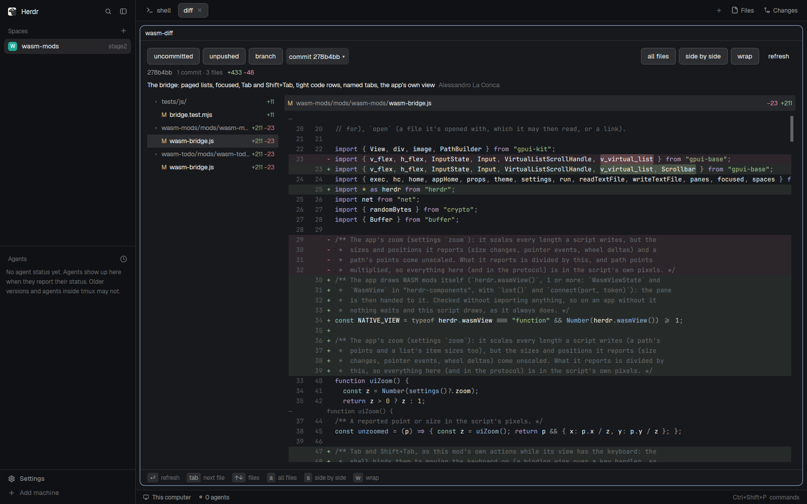

# WASM diff

What changed in the tab's git repo, as a sandboxed WebAssembly mod in a Herdr
pane: uncommitted changes, unpushed commits, the whole branch or one commit,
as a file tree and a syntax-coloured diff. It reads the repo only through the
host, which runs git's reading commands for it once you allowed it, and keeps
its view toggles in `~/.local/share/wasm-mods/diff`.
**commit ▾** picks one of the branch's recent commits. Needs WASM Mods host
0.2.0: the first time
it's shown on a machine without it, it offers to install it.

## What you see

- The first time: "wasm-diff asks to:", "what changed: uncommitted,
  unpushed, the branch, a commit", four bullets ("know the folder and git
  branch of the tab it's in", "read the git history and changes of that
  folder", "read files in ~/.local/share/wasm-mods/diff", "change files in
  ~/.local/share/wasm-mods/diff") with their ids (`window.folder`, `git`,
  `fs.read:…`, `fs.write:…`) in small `dim` text,
  **Allow** and **Deny**.
- Then, in Herdr's theme:
  - a row of pills: **uncommitted**, **unpushed**, **branch**, **commit ▾**
    (the shown commit's short hash ▾ when there is one), the current one
    filled; then, on the right (on a second row under 820px), **all files**,
    **side by side**, **wrap** and **refresh**;
  - a summary: the range (`HEAD` against the working tree, `origin/main..HEAD`,
    …), "N commits · N files", `+added` in green and `−removed` in red; for
    one commit, its subject and author under it;
  - on the left, 260px wide (on top, 120px high, under 640px): the changed
    files as a tree, a folder with ▾ (▸ folded) and its name in `subtext`, a
    file with its status letter (M, A, D, R, ? for untracked) coloured, its
    name, and its `+`/`−` counts (`bin` for a binary);
  - on the right, the diff in monospace: the file's bar (its path and
    counts), then hunk headers and lines with their old and new line numbers,
    added lines on a green tint and removed ones on a red tint, the changed
    words marked brighter, and syntax colours from the theme's ANSI colours;
    a vertical scrollbar at the right, always shown;
  - "no changes in this range" when there are none;
  - at the foot, the hints "⏎ refresh", "tab next file", "↑↓ files",
    "a all files", "s side by side", "w wrap".

## How it behaves

- Opening, it shows the uncommitted changes (or, opened with a commit hash as
  its `arg` prop, that commit). A pill switches the source; **commit ▾** lists
  the branch's last 40 commits (when, subject), and a click shows that one,
  its subject and author under the pills.
- ↑/↓ (or j/k) move in the file tree and show that file's diff; a click on a
  folder's arrow, or ⏎ on a folder, folds it. Tab goes to the next file,
  Shift+Tab to the previous one.
- PageUp/PageDown scroll the diff by a screen, Home/End to its top and end;
  the scrollbar drags. The arrows stay with the file tree until you click
  into the diff.
- a shows every file's diff one after another, the bar showing the file
  scrolled to; s switches to side by side; w wraps long lines (unwrapped,
  ←/→ scroll sideways).
- ⏎ (or **refresh**) reads it all again. While the pane has the keyboard it
  also looks again every 4 seconds (not for one commit, which doesn't
  change).
- Untracked files are listed but not shown: their content is outside git.
- Deny: the pane says what it's waiting for, and nothing is read.

## Built from

- The bridge, `wasm-bridge.js`, is the same file as in the `wasm-mods` card;
  build it from that recipe. `main.js` is only
  `import { wasmMod } from "./wasm-bridge.js"; export default wasmMod({ folder: "wasm-diff", module: "diff" });`
  and `mod.json` is `{"place": "none", "title": "diff"}`.
- `diff.wasm`: the module, built from `modules/diff` with the `wasm-mods-sdk`
  crate for `wasm32-unknown-unknown`
  (`cargo build --release --target wasm32-unknown-unknown`). It's protocol 5.
- `host.lock.json` pins host 0.2.2 (protocol 4 to 5), by URL and SHA-256 per
  machine (`linux-x86_64`, `linux-aarch64`, `macos-aarch64`, `macos-x86_64`),
  and the module's own SHA-256 and protocol.
- The module: `manifest!(description: "what changed: uncommitted, unpushed,
  the branch, a commit", capabilities: ["window.folder", "git",
  "fs.read:~/.local/share/wasm-mods/diff",
  "fs.write:~/.local/share/wasm-mods/diff"])`. The toggles (all files, side by
  side, wrap) are kept in `settings.json` there, for the next diff opened. It runs
  `git status`, `rev-parse`, `merge-base`, `rev-list`, `for-each-ref`,
  `branch`, `ls-files`, `log` and `diff --numstat` / `diff` per file with
  `run_tool("git", id, args)`, at most 4 at once, and reads the answers in a
  later call. Syntax colours come from syntect's default syntaxes, mapped to
  the theme's ANSI colours. The diff's lines are a virtual list marked as
  the module's page (`.pages()`, protocol 5): only the rows near those
  showing are sent, and the bridge gives it PageUp/PageDown/Home/End and a
  scrollbar. It polls on `input.focused`, which the bridge sends when the
  pane's focus changes.

## Watch out

- The folder must stay self-contained: Herdr refuses imports from outside a
  mod's folder, so the bridge is a copy here, and the module and its lock sit
  beside it.
- Every file's diff is read at once (one `git diff` per file) and coloured in
  slices in the background (`Output::busy()`: the host calls again with no
  events until it's done), so a big change set opens fast and fills in.

## Done when

- `herdr-app check` passes for `wasm-diff`.
- In a tab on a git repo with a changed file, `tab.new {"mod": "wasm-diff"}`
  shows the prompt with `window.folder`, `git` and the two `fs` ones. Allow: the file tree and
  the first file's diff show, syntax-coloured.
- PageDown scrolls the diff by a screen and the scrollbar follows; ⏎ on a
  folder folds it; a shows all files.
- **commit ▾**, then a commit in the list: its diff shows, the pill reads
  "commit <hash> ▾".
- Deny (or the core mod's Deny) leaves the pane waiting, with no git run.
