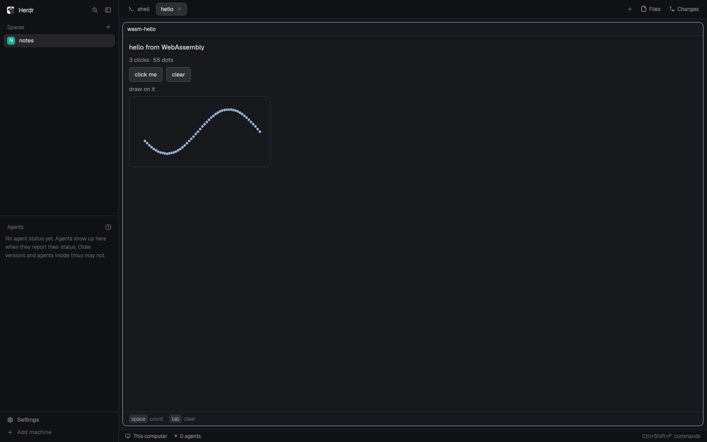

# WASM hello

The smallest WASM mod, and the template for new ones: a counter, two buttons
and a canvas to draw on, running as sandboxed WebAssembly in a Herdr pane. It
asks for no permissions. Needs the WASM Mods core: the first time it's shown
on a machine it offers to install it.

## What you see

- A tab (or a layout block) in Herdr's theme, 14px padding:
  - "hello from WebAssembly" (14px semibold), then "N clicks · N dots" in
    `muted`;
  - **click me** and **clear**, outlined buttons;
  - "draw on it", then a 320×160 canvas: the theme's tile corners, `surface`
    at half alpha, a 1px `border`. Pressing and dragging leaves 3px `accent`
    dots.
  - At the foot, under a 1px `border` rule: the hints "space count" and
    "tab clear" (11.5px, `dim`, keys in `surface` chips).

## How it behaves

- **click me** or space adds a click; **clear** or tab clears the dots.
- Pressing or dragging on the canvas adds a dot where the pointer is. Only the
  latest drag position per frame arrives, so a fast drag leaves spaced dots.
- Its state is kept across a new build installed while it's shown.
- First show with no host: the core-needed panel (see the `wasm-mods` card).

## Built from

- The bridge, `wasm-bridge.js`, is the same file as in the `wasm-mods` card;
  build it from that recipe. `main.js` is only
  `import { wasmMod } from "./wasm-bridge.js"; export default wasmMod({ folder: "wasm-hello", module: "hello" });`
  and `mod.json` is `{"place": "none", "title": "hello"}`.
- `hello.wasm`: the module, built from `modules/hello` with the
  `wasm-mods-sdk` crate for `wasm32-unknown-unknown`
  (`cargo build --release --target wasm32-unknown-unknown`).
- `host.lock.json` pins the host this release was tested with, by URL and
  SHA-256 per machine (`linux-x86_64`, `linux-aarch64`), and the module's own
  SHA-256 and protocol.
- The module: `Frame::update` counts `Event::Clicked { id: "more" }` and
  `Action::Primary`, clears on `"clear"` and `Action::Secondary`, adds a dot
  on `Event::Pointer` Down/Drag on `"pad"`, and returns
  `column([heading, muted, row([button, button]), muted, canvas("pad", 320,
  160, shapes)])` with `.action(Primary, "count")` and
  `.action(Secondary, "clear")`. `manifest!(capabilities: [])`.

## Watch out

- The folder must stay self-contained: Herdr refuses imports from outside a
  mod's folder, so the bridge is a copy here, and the module and its lock sit
  beside it.
- With no host on the machine, the pane shows the core-needed panel
  (Download, checksum pinned, or Build from source) before the module runs;
  see the `wasm-mods` card.

## Done when

- `herdr-app check` passes for `wasm-hello`.
- `tab.new {"mod": "wasm-hello"}` on a machine with the host shows hello with
  no permission prompt; without it, the core-needed panel.
- Three clicks on **click me** read "3 clicks"; space adds one more.
- Dragging on the canvas leaves dots and the count follows; **clear** empties
  it.
