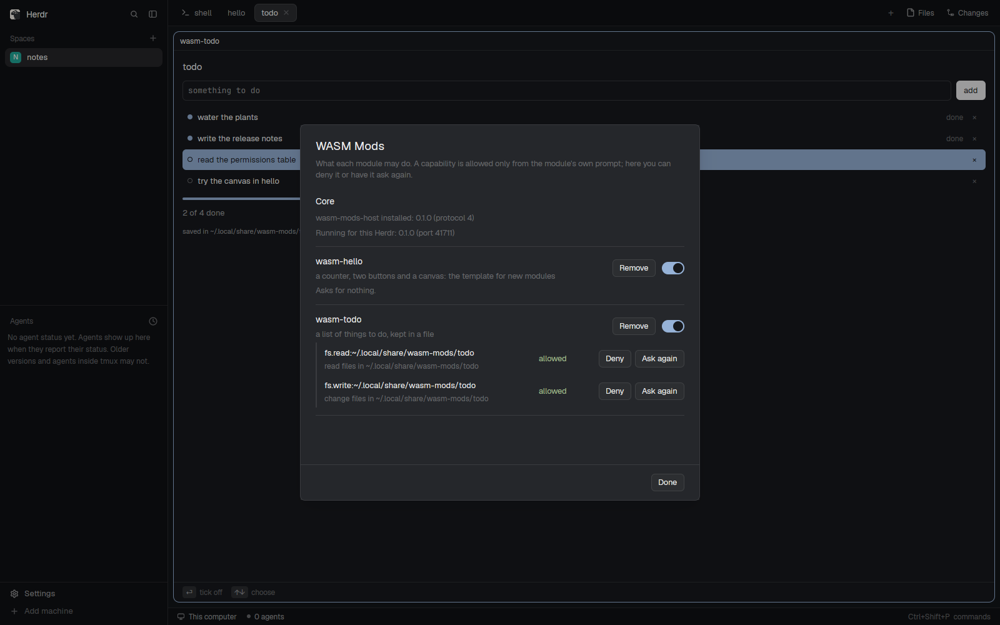

# WASM Mods

The core of WASM Mods: small apps compiled to WebAssembly, shown in Herdr
panes, each allowed only what you said yes to. This mod is the screen that
lists every installed WASM mod with what it asked for and your answers (deny,
ask again, turn off, remove) and the hosts installed. It's also the host
installer every WASM mod shares: the first WASM mod shown on a machine offers
to install the small host program, checked against a pinned SHA-256. Add WASM
mods such as `wasm-todo` beside it. Each works without this one; this one is
where you manage them.

## What you see

- **WASM Mods core needed**, in a module's pane while no installed host runs
  its protocol: a column centered in the pane, 620px wide at most, 16px padding.
  - "WASM Mods core needed" (heading), then "<module> runs in wasm-mods-host,
    the small program that keeps WASM mods sandboxed. No host installed here
    runs it (protocol N).";
  - "Installs wasm-mods-host X.Y.Z (protocol N) into
    ~/.local/share/wasm-mods/host/X.Y.Z/, beside any other version. Nothing is
    removed.";
  - "From:", then the URL and "sha256 <64 hex>" in monospace `dim`;
  - "Or built here from <git> (<tag>) with cargo." when cargo and the wasm32
    target are installed;
  - **Download vX.Y.Z (N MB, checksum pinned)** (solid) and **Build from
    source** (outlined). While working, "Downloading…" or "Building… (a few
    minutes)" with the build log's last line. A failure shows in red under
    the buttons.
- **A module's pane** (a tab of its own, or a block in a layout): a 14px
  padded column in Herdr's theme. The background is the theme's `background`,
  13px UI text in `foreground`, headings 14px semibold. Under the content,
  a 1px `border` rule and a hint row, 11.5px in `dim`. Each hint is a key
  in a rounded `surface` chip and what it does ("space count", "tab clear",
  "⏎ tick off", "↑↓ choose"). Clicking a hint does it.
- **The permission prompt**, drawn in the module's place until answered:
  - "<module> asks to:" (heading), then its description in `muted`;
  - one bullet per capability, in plain words ("read files in
    ~/.local/share/wasm-mods/todo"), with its id after it in small `dim` text;
  - a red "⚠ a broad grant" line under a folder that is your home, `/`,
    `~/.ssh` or `~/.config`;
  - **Allow** (solid) and **Deny** (outlined), then "remembered for this
    build; a new build asks again".
- **WASM Mods**, the core mod (a 640px dialog): the title, a line saying
  a capability is allowed only from the module's own prompt, a **Core**
  section ("wasm-mods-host installed: X.Y.Z (protocol N)", "Running for this
  Herdr: X.Y.Z (port N)"), then one section per module:
  - its name and its description;
  - "Asks for nothing.", or one row per capability: the id, the plain
    words, and the answer ("allowed" green, "denied" red,
    "asks" muted) with **Deny** / **Ask again** buttons;
  - **Remove** and an on/off switch at the right.
  - At the foot: the last change ("todo: denied") and **Done**.

## How it behaves

- First show on a machine with no fitting host: the core-needed panel.
  **Download** fetches the lock's URL with curl (HTTPS only, redirects HTTPS
  only, 100 MB and 300 s at most), checks its SHA-256 against the lock, and
  only then moves it into `~/.local/share/wasm-mods/host/<version>/`. A
  mismatch says so in red and installs nothing. **Build from source** runs
  `cargo install --locked --git <git> --tag <tag> --root <tmp> wasm-mods-host`
  in a hidden terminal, checks the result's `--version --json`, and installs
  it the same way. Then the pane connects and the module starts.
- Every mod uses the newest installed host whose protocol range covers its
  module. A newer one installed later takes the new connections, and the old
  one exits when its last pane closes. A mod never replaces or deletes a
  host.
- A mod copies its `<name>.wasm` into `~/.local/share/wasm-mods/modules/` when
  that copy's SHA-256 differs.
- The module's prompt asks for every capability nobody answered
  yet. Allow grants them for this exact build (its SHA-256), Deny refuses
  them. The module then runs with what it got: a refused file read answers
  with an error the module shows.
- Keys go to the module as actions, never raw keys: space = primary, tab =
  secondary, ⏎ = open, Esc = back, arrows/j/k/PageUp/PageDown/Home/End move
  a list's selection. In a focused text field every key types, and Esc leaves
  the field.
- The core mod: **Deny** refuses at once; **Ask again** forgets the answer
  (the module's prompt returns when it next needs it); the switch turns a
  module off (its panes say so) or on; **Remove** asks to confirm, then
  deletes your module and its answers. Allow isn't offered here. Esc or **Done** closes it.
- A new build of a module installed while it's shown reloads it in place,
  keeping its state. A host that went away (killed, crashed) is started again
  and the panes reconnect.

## Built from

- Every mod folder: `main.js` (`export default wasmMod({ folder:
  "wasm-todo", module: "todo" })`), `mod.json` (`{"place": "none", "title":
  "todo"}`), `wasm-bridge.js` (the same file in every WASM mod
  folder), `<module>.wasm`, and
  `host.lock.json`: `{"host": {"version", "protocol": [min, max], "files":
  {"linux-x86_64": {"url", "sha256", "size"}, "linux-aarch64": …}, "source":
  {"git", "tag"}}, "module": {"name", "protocol", "sha256"}}`, written when
  the release is packaged.
- `wasm-bridge.js`:
  - starts `wasm-mods-host` in a hidden herdr-core terminal:
    `hc(["run", "--bg", "--json", "--no-parent", "--rm", "--", host,
    "--token-file", f, "--port-file", p, "--host-file", h])`;
  - connects over `net` to 127.0.0.1 with a 48-hex-char token passed in a
    0700 folder (`~/.cache/wasm-mods/run/`), one connection per pane. Lines of
    JSON go both ways: `hello`, `size`, `theme`, `window`, `events`
    out; `ready`, `frame`, `error`, `focus`, `close`, `open`, `open_url` in;
  - draws the module's node tree (Column, Row, Text, TextField, List,
    Canvas, Popup) with gpui-kit/gpui-base elements: `v_flex`, `h_flex`,
    `Input`/`InputState`, `v_virtual_list`, `PathBuilder` for canvases;
  - reads `theme()`, `settings()` (zoom, font), `panes()`, `focused()`,
    `spaces()`; runs `pane.close` and `tab.new`, and `xdg-open`
    for a link the user clicks.
  - finds hosts by listing `~/.local/share/wasm-mods/host/*/wasm-mods-host`
    and asking each `--version --json` (`{"version", "protocol": [min,
    max]}`), and runs the module only on one that fits;
  - Props: `module` (the core mod only), `arg`, `open`.
- `mods/wasm-mods/` (the core mod): `main.js` shows `core.js`'s screen when
  opened alone, or runs any installed module named in `props.module`.
  `core.js` runs `wasm-mods-host --permissions` (JSON) and
  `--deny/--forget/--enable/--disable/--remove` through `exec`, and decides
  nothing itself. `mod.json` makes it a 640px dialog.
- `wasm-mods-host` (Rust, wasmtime): runs each `.wasm` with no imports, 500 ms
  and 256 MB per call, and keeps the answers in
  `~/.config/wasm-mods/permissions.toml`. Files go through `openat` with
  `O_NOFOLLOW`. git is read-only, with no shell, and runs through
  `hc exec --on` for another machine's tab.
- Modules: Rust crates for `wasm32-unknown-unknown` with `wasm-mods-sdk`,
  each with a `manifest!` naming its capabilities.

## Watch out

- herdr-app 0.1.11 never fires `InputState.on("focus")` for a clicked field.
  A root `on_key_down` that waits for it takes space, j/k and the arrows from
  the field. Ask the root's focus handle (`is_focused()`) instead: a key that
  reaches the root while the root doesn't hold the keyboard belongs to a
  field.
- The app's zoom scales every length a script writes but not the sizes and
  positions it reports, nor a path's points. Divide reported values by
  `settings().zoom`, and multiply path points by it.
- Don't write anything into a mod's own folder while it runs: any change
  there reloads every copy. Canvas pictures go under the app home's
  `data/wasm-mods/images/`.
- One host for every pane: copies find it through the run file, the host
  writes that file itself, and a mkdir lock picks who starts it. A copy
  closed mid-start must not leave the others waiting.
- A reconnect must send the theme again: the host draws nothing without one.
- A mod imports nothing from outside its own folder: Herdr refuses imports
  that resolve outside it, symlinks too. That's why every folder carries the
  bridge.
- Never trust a lock's URL alone: the SHA-256 in the lock is what makes a
  download safe. Check it before moving the file into place, and download into
  a temporary folder.
- Linux only: the host reads `/proc` and uses the XDG portal.

## Done when

- On a fresh home (no host, no `~/.local/share/wasm-mods`), copying the
  release's `wasm-mods`, `wasm-hello` and `wasm-todo` folders into `mods/`:
  `herdr-app check` passes for each, and `tab.new {"mod": "wasm-hello"}`
  shows the core-needed panel with the lock's URL and SHA-256.
- **Download** installs `host/X.Y.Z/wasm-mods-host`, whose SHA-256 is the
  lock's, and hello starts. A file whose SHA-256 differs is refused, with
  nothing installed.
- **Build from source** (host folder removed first) builds and installs the
  same version, and hello starts.
- `herdr-app status` lists no errors.
- `mod.open {"name": "wasm-mods"}` lists the installed host and hello ("Asks for nothing.")
  and todo (two rows, "allowed"). **Deny** on the read row writes
  `denied` in `permissions.toml`; **Ask again** clears it, and after a reload
  todo asks for that one again.
- Killing `wasm-mods-host` while hello is shown: the pane comes back on a new
  host within seconds.
- At zoom 1.4 nothing is cut off or misplaced.
