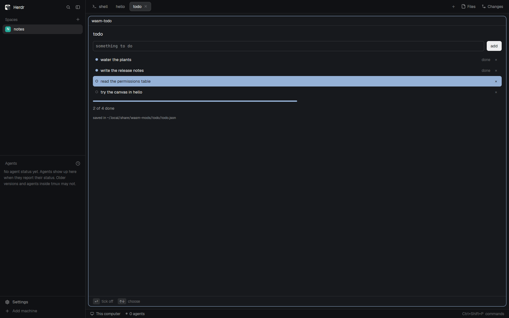

# WASM todo

A list of things to do, kept in a file, as a sandboxed WebAssembly mod in a
Herdr pane. Before it reads or writes anything it asks you, in its pane, for
one folder: `~/.local/share/wasm-mods/todo`. Needs the WASM Mods core: the
first time it's shown on a machine it offers to install it.

## What you see

- The first time: "wasm-todo asks to:", "a list of things to do, kept in a file",
  two bullets ("read files in ~/.local/share/wasm-mods/todo", "change files
  in ~/.local/share/wasm-mods/todo") with their ids in small `dim` text,
  **Allow** and **Deny**, and "remembered for this build; a new build asks
  again".
- Then, in Herdr's theme with 14px padding:
  - "todo" (heading);
  - a monospace text field ("something to do") and an **add** button;
  - the list: a ring and the text for open items, a filled `accent` dot and
    "done" for finished ones, × at the right of each; the selected row in the
    accent fill;
  - a progress bar, "N of M done", and "saved in
    ~/.local/share/wasm-mods/todo/todo.json" in small `dim` text;
  - at the foot, the hints "⏎ tick off" and "↑↓ choose".

## How it behaves

- Allow grants both folder permissions for this build. Deny refuses them,
  and the host's refusal shows in red where "saved in …" would be.
- Type and press ⏎ (or **add**): the item is added and selected. In the field
  every key types; Esc leaves it.
- ↑/↓ (or j/k) choose an item; ⏎ or space ticks it off or on; a click ticks
  it; × removes it.
- Every change rewrites `todo.json` (a JSON array of `{text, done}`), through
  the host, only inside the allowed folder.
- The core mod's screen can deny, forget (it asks again), turn todo off, or
  remove it.

## Built from

- The bridge, `wasm-bridge.js`, is the same file as in the `wasm-mods` card;
  build it from that recipe. `main.js` is only
  `import { wasmMod } from "./wasm-bridge.js"; export default wasmMod({ folder: "wasm-todo", module: "todo" });`
  and `mod.json` is `{"place": "none", "title": "todo"}`.
- `todo.wasm`: the module, built from `modules/todo` with the
  `wasm-mods-sdk` crate for `wasm32-unknown-unknown`
  (`cargo build --release --target wasm32-unknown-unknown`).
- `host.lock.json` pins the host this release was tested with, by URL and
  SHA-256 per machine (`linux-x86_64`, `linux-aarch64`), and the module's own
  SHA-256 and protocol.
- The module: `manifest!(description: "a list of things to do, kept in a
  file", capabilities: ["fs.read:~/.local/share/wasm-mods/todo",
  "fs.write:~/.local/share/wasm-mods/todo"])`. It reads `todo.json` with a
  file effect on its first call (no file yet: an empty list), adds on
  `Event::Submitted`, ticks on `Event::Activated` and `Action::Primary`,
  removes on `Clicked { id: "remove/<i>" }`, and whenever the list changed
  makes the folder and writes the whole list back. A file error shows in red
  in place of "saved in …".

## Watch out

- The folder must stay self-contained: Herdr refuses imports from outside a
  mod's folder, so the bridge is a copy here, and the module and its lock sit
  beside it.
- With no host on the machine, the pane shows the core-needed panel
  (Download, checksum pinned, or Build from source) before the module runs;
  see the `wasm-mods` card.
- A refused read comes back as an error in a later call; show it rather
  than an empty list, so a denied permission isn't mistaken for no items.

## Done when

- `herdr-app check` passes for `wasm-todo`.
- `tab.new {"mod": "wasm-todo"}` shows the prompt with the two folder
  capabilities. Allow, then type "water the plants" ⏎: the list shows it with
  its spaces, and `~/.local/share/wasm-mods/todo/todo.json` holds it.
- Esc, then space ticks the selected item, and "1 of 1 done" shows.
- Deny (or the core mod's Deny) leaves the file untouched.
